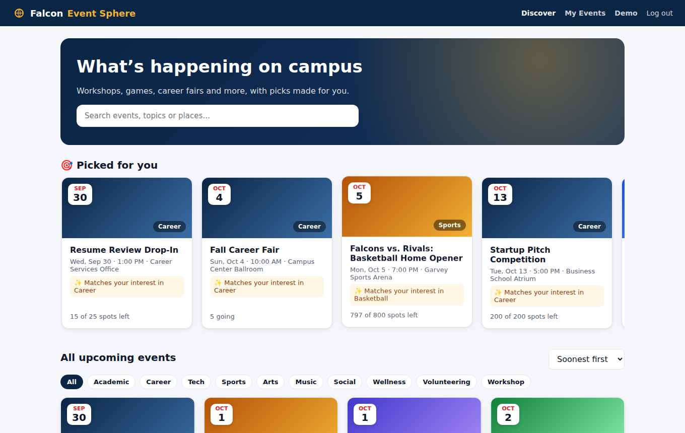
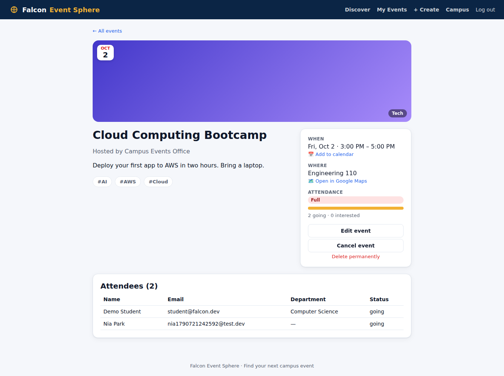
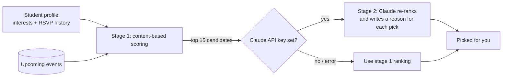

# 🦅 Falcon Event Sphere

**Campus event discovery with AI-powered recommendations.** Students find workshops, games, career fairs and club events in one place, RSVP in a click, and get a personal "Picked for you" feed. Organizers publish events, cap attendance, and see who's coming.




## Features

**For students**
- Browse, search and filter upcoming events by category, sorted by date or popularity
- **Personalized recommendations**, each with a reason ("Matches your interest in AI", "Similar to *Fall Career Fair*")
- RSVP as **Going** or **Interested**, with live "spots left" counts
- **Add to calendar** (.ics works with Google, Outlook and Apple Calendar) and **Open in Google Maps**
- *My Events*: upcoming and past events you're going to or interested in
- Profile with interests that tune the recommendations

**For organizers**
- Create, edit, cancel or delete events, with optional capacity and a banner image
- Attendee list with name, email, department and RSVP status
- Capacity can't be lowered below the number of students already going



## Tech stack

| Layer     | Technology                                                  |
|-----------|-------------------------------------------------------------|
| Frontend  | React 19, TypeScript, Vite, React Router                    |
| Backend   | Node.js, Express 5, Zod validation                          |
| Database  | MongoDB with Mongoose                                       |
| AI        | Claude API (Anthropic SDK) for recommendation re-ranking    |
| Auth      | JWT, bcrypt, role-based access (student / organizer), rate-limited login |
| Testing   | Jest, Supertest, mongodb-memory-server                      |
| DevOps    | Docker, Docker Compose, nginx, GitHub Actions CI            |

## How the recommendation engine works



**Stage 1: content-based scoring (always on).** Each upcoming event gets points for:
- matching the student's interests by category (+3) or by tag (+2 each)
- being similar to events they've RSVP'd to before (same category or shared tags)
- small boosts for popularity (log of the going count) and for happening within 7 days

Events the student already RSVP'd to, or organizes, are excluded. New students with no interests or history see the most popular events.

**Stage 2: LLM re-ranking (optional).** If `ANTHROPIC_API_KEY` is set, the top 15 candidates and the student's profile go to Claude. The model picks the best matches and writes a short, specific reason for each. The server:
- only accepts event ids that were in the candidate list, so it can't return an event that doesn't exist
- falls back to stage 1 on any error or timeout, so the page never breaks
- caches results for 5 minutes per student and clears that cache when they RSVP or change their interests

## Design decisions

**No overbooking.** Each event stores `seatsLeft`. RSVPing runs one atomic MongoDB update, *"decrement `seatsLeft` only if it's greater than 0."* Two students clicking the last seat at the same moment can't both get it. A test fires 8 simultaneous RSVPs at a 3-seat event and checks that exactly 3 succeed.

**Consistent counters.** Switching Going → Interested → Going, or cancelling, adjusts `goingCount`, `interestedCount` and `seatsLeft` together. If saving the RSVP fails after a seat was taken, the seat is released again.

**Safe search.** Search input is regex-escaped, so typing characters like `(((` can't break the query or be used for a regex-based denial of service.

**Public browsing, protected actions.** Anyone can browse events. RSVPing requires login, and editing requires being that event's organizer.

## Getting started

### Option 1: Docker (easiest)

```bash
docker compose up --build
docker compose exec server npm run seed    # optional: load 16 demo events
```

Open **http://localhost:8080**. Demo logins (password `password123`):
- `student@falcon.dev`: a student interested in AI, Career and Basketball
- `organizer@falcon.dev`: can create and manage events

To turn on AI recommendations, create a `.env` file next to `docker-compose.yml` containing `ANTHROPIC_API_KEY=your-key`, then restart.

### Option 2: Run locally

Requires Node.js 18+ and MongoDB on `localhost:27017` (or run `docker compose up mongo`).

```bash
# Backend
cd server
cp .env.example .env      # set JWT_SECRET (and ANTHROPIC_API_KEY if you want AI picks)
npm install
npm run seed              # optional demo data
npm run dev               # http://localhost:4000

# Frontend (second terminal)
cd client
npm install
npm run dev               # http://localhost:5173
```

### Environment variables (`server/.env`)

| Variable            | Purpose                                                   |
|---------------------|-----------------------------------------------------------|
| `PORT`              | API port (default 4000)                                   |
| `MONGO_URI`         | MongoDB connection string                                 |
| `JWT_SECRET`        | Signs login tokens (required in production)               |
| `JWT_EXPIRES_IN`    | Token lifetime, e.g. `7d`                                 |
| `CLIENT_ORIGIN`     | Allowed CORS origin(s), comma-separated                   |
| `ANTHROPIC_API_KEY` | Optional. Turns on Claude re-ranking of recommendations   |
| `ANTHROPIC_MODEL`   | Optional. Defaults to `claude-haiku-4-5-20251001`         |

## Tests

```bash
cd server
npm test
```

The tests cover:
- auth and roles
- event validation, search, filters and ownership rules
- RSVP counter logic and the **concurrent overbooking test**
- calendar export
- the recommendation engine, including the LLM path (with a mocked model) and the fallback when the model fails

GitHub Actions runs them against a real MongoDB on every push, plus the client lint and build.

## API reference

| Method | Route                              | Who               | Description                           |
|--------|------------------------------------|-------------------|---------------------------------------|
| POST   | `/api/auth/register`               | anyone            | Sign up (student or organizer)        |
| POST   | `/api/auth/login`                  | anyone            | Log in → `{ token, user }`            |
| GET    | `/api/auth/me`                     | logged in         | Current user                          |
| PATCH  | `/api/auth/me`                     | logged in         | Update name, department, interests    |
| GET    | `/api/events`                      | anyone            | Browse: `q`, `category`, `sort`, `page` |
| GET    | `/api/events/:id`                  | anyone            | Event details (+ your RSVP if logged in) |
| GET    | `/api/events/:id/calendar.ics`     | anyone            | Calendar file                         |
| POST   | `/api/events`                      | organizer         | Create event                          |
| PATCH  | `/api/events/:id`                  | event owner       | Edit / cancel event                   |
| DELETE | `/api/events/:id`                  | event owner       | Delete event and its RSVPs            |
| GET    | `/api/events/:id/attendees`        | event owner       | Who's coming                          |
| PUT    | `/api/events/:id/rsvp`             | logged in         | `{ status: "going" \| "interested" }` |
| DELETE | `/api/events/:id/rsvp`             | logged in         | Remove RSVP                           |
| GET    | `/api/me/events`                   | logged in         | Going / interested / hosting          |
| GET    | `/api/me/recommendations`          | logged in         | Personalized picks with reasons       |

## Project structure

```
falcon-event-sphere/
├── server/
│   ├── src/
│   │   ├── models/        # User, Event, Rsvp
│   │   ├── routes/        # auth, events (+ RSVP, attendees, calendar), me
│   │   ├── services/      # rsvpService (atomic seats), recommender (scoring + LLM)
│   │   ├── middleware/    # auth & roles, validation, errors
│   │   └── utils/         # .ics builder, serializers
│   ├── scripts/seed.js    # demo data
│   └── tests/
├── client/src/
│   ├── pages/             # Discover, Event, EventForm, MyEvents, Profile, Auth
│   ├── components/        # EventCard, InterestPicker
│   └── lib/               # API client, auth context, formatting
├── docker-compose.yml
└── .github/workflows/ci.yml
```

## Possible next steps

- Email reminders the day before an event (a scheduled job, e.g. AWS EventBridge + SES)
- Waitlist that promotes the next student automatically when someone cancels
- Image uploads to S3 instead of image URLs
- Deploy: frontend on Vercel or S3 + CloudFront, API on AWS (Elastic Beanstalk / ECS), database on MongoDB Atlas

## License

MIT
